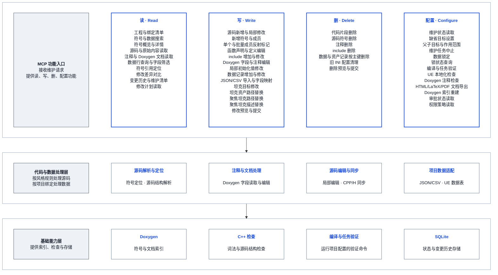

# UnrealEngineCPPCodingMCP 0.1.0

面向 UE5 工程的 C++ 代码 MCP。

这是新的独立交付，不覆盖 DoxygenUnrealEngine 0.3.0，也不是 Doxygen 内核 fork。保留了既有、已验证的 Doxygen/C++ 局部编辑引擎；新入口把项目数据与源码放进同一套 **Read / Write / Delete / Configure**。Skill 决定解决问题的顺序，程序执行可验证的范围、字段、版本、锁和任务测试。

## 分层功能架构



<details>
<summary>Mermaid 源码</summary>



</details>

## 先运行实际例子

需要 CPython 3.10+。GUI 需要 Tk（Windows 官方 Python 安装选项 Tcl/Tk）；运行产品不需要 pip。数据模式不需要 Doxygen。代码功能需要 Doxygen；便携 C++ 验收需要 g++ 或 clang++，不是 UE 构建。

1. 解压，双击 `Start-GUI.cmd`，点击“新建演示副本”。它只复制包内例子到新临时目录。
2. 搜索“单位”，选 `overview`。看到既有 Units 数据入口，增改页填 rows 或源文件映射，先预览再提交。切勿把演示字段照搬到实际游戏。
3. 代码演示需要 Doxygen：已有程序可选择路径；没有则运行 `Bootstrap-Doxygen.cmd`（下载固定官方 Windows 版本并核对 SHA256）。在演示中切换“代码维护模式”。
4. `Run-Demo.cmd` 自动重放三种任务及反例，最后打印实际项目副本和日志路径。`Run-Tests.cmd` 跑回归。测试没有安装 Doxygen 时，代码类测试会明确跳过，不能据此声称全部路径通过。

Linux/macOS：`python Run.py gui`。显式配置：

```sh
python Run.py server --project /path/to/project --profile /path/to/approved-profile.json --doxygen /path/to/doxygen --state-db /outside/project/state.sqlite3
```

## 交付包含什么

- 既有 JSON/CSV 表：按主键增改；省略记录和字段保留；映射批量文件，不经过模型抄写全部数据。主键、类型、引用、源码范围和任务测试由用户选定的本地 profile 决定。
- 既有 C++：搜索 brief/概览/完整文档、正常缩短编辑、普通成员 CPP/H 同步、include、源码注释字段、函数差异；真实编译/任务验证失败回滚。
- UE：保留 UFUNCTION 调用语义、模块依赖文字证据、Content/配置可见；附编辑器内执行的真实 DataTable 适配器。该适配器在此环境只执行 API 契约测试，未在 UE 中执行。
- 本地 GUI：真实 MCP 请求和返回；锁、独立删除审批、源码事务恢复；Codex 配置文本与 Skill 安装。默认只有一份结构化返回，旧客户端可启用单份 text 模式。
- Skill：数据能表达就改数据；接口能满足就调用；确实缺少能力才扩展拥有该职责的系统。没有强制阅读阶梯、target_id、搜索凭证或每次填写的设计报告。

## 核心限制

这是有明确支持范围的实现，不是自动架构证明器。`forbid_added_tokens` 只是用户已知模式的词法门禁；未知的职责重复依赖工程证据、Skill 判断与实际任务验证。附带的计数成本测试只是一个反例验收，不是任意项目自动生成的性能标准。

不支持 SQLite/SQL 写入、INI 写入、星际地图二进制格式解码、任意 UAsset/Blueprint 图修改、全量 C++ 调用点重构或完整 UHT 语义。输入文件单个最多16 MiB、表最多100000行；源码索引首次扫描和变化重建的整 UE 工程性能没有测量。不要以例子的速度推断真实项目。

同一系统账户的任意 Shell 权限可以绕开此 MCP。GUI 点击不是 OS 身份认证。没有连接实际 UE 时，资产操作明确失败，不伪造结果，也不改 C++ 兜底。

## 文档

- [生成开发者/用户网页、五类 API 和增量翻译](docs/WEBSITE_ZH.md)

- [使用手册](docs/MANUAL_ZH.md)
- [四工具实际清单](docs/TOOLS.md) / [运行中 tools/list](docs/TOOLS.json)
- [配置已有项目](docs/PROFILE_ZH.md)
- [UE 编辑器 DataTable 通道](editor/README.md)
- [可控范围与验收](docs/ACCEPTANCE_ZH.md)
- [Skill](.agents/skills/ue-maintenance/SKILL.md)
- [证据](evidence/README.md)

`Install-Windows.cmd` 是 Python 本地安装脚本，不是自包含 Setup.exe；它校验清单，安装到新的版本目录，不覆盖旧目录，不改用户项目。没有在 Windows 做过安装验收。见 NOTICE.md 的来源和许可边界。

## 本地维护修订

[2026-09-19 修复、验证与已知限制](docs/LOCAL_MAINTENANCE_20260919.md)。

## 本地化遗漏检查

`Configure(action="check_localization", name="Game")` 读取项目原生 `Game.manifest` 与中文、英文 `Game.archive`，报告缺失或空译文、源文本变化及中文原文换行不一致。返回 `gathered`、`missing`、带来源位置的 `gaps`；空采集报错，不能当作零遗漏。先使用 UE Localization Dashboard 的 Gather Text 更新采集结果，再检查；导入和编译仍由 UE 原生本地化工具负责。

代码预览新增 `FText::FromString(TEXT(...))`、`FText::FromString(FString::Printf(TEXT(...)))` 或 `AsCultureInvariant` 普通文字时，返回 `localization_warnings`，提示使用已有本地化 FText、LOCTEXT/NSLOCTEXT 或字符串表身份。检查不修改语言、资产、权限或运行时 UI。

需要按界面检查时可使用 CLI：

```sh
python tools/check_localization.py --manifest PROJECT/Content/Localization/Game/Game.manifest --archive zh=PROJECT/Content/Localization/Game/zh-Hans-CN/Game.archive --archive en=PROJECT/Content/Localization/Game/en/Game.archive --namespace Winyunq.UI
```

`--location` 支持原生采集来源通配符；`--project PROJECT --editor UnrealEditor-Cmd.exe` 可调用 UE 原生采集并把检查中间文件放入 Saved/LocalizationChecks。发现遗漏时退出码为 1。原生采集覆盖有身份的 FText；动态 FString、运行时拼接或明确不可本地化文本仍需核对实际界面。代码预览的字面量提示仅检查本次新增片段。MCP 服务重启后加载新增动作和提示。
